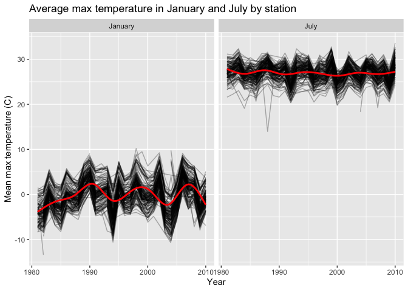
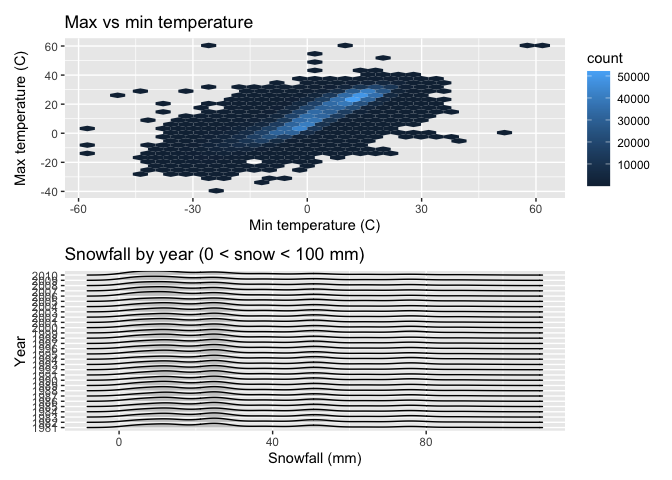
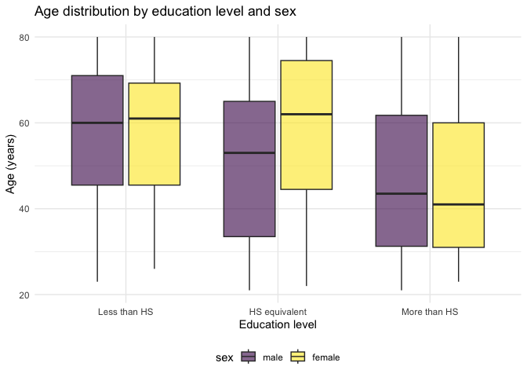
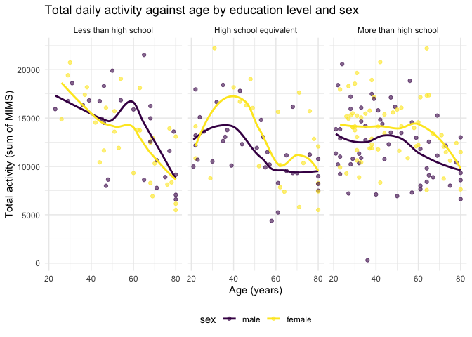
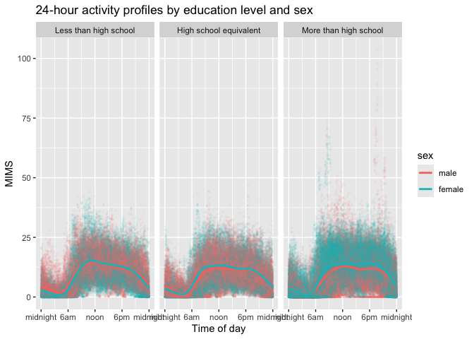
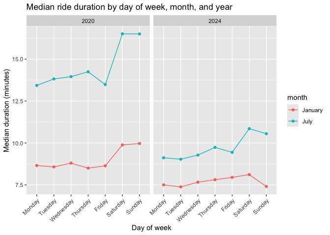
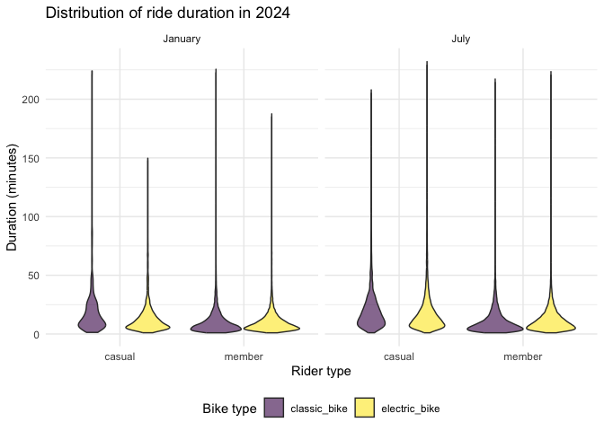

p8105_hw3_anh2179
================
2026-10-16

``` r
library(tidyverse)
library(p8105.datasets)
library(ggridges)
library(patchwork)
library(hexbin)
```

## Problem 1

This problem uses the NY NOAA dataset, which contains daily weather
observations from weather stations across New York State.

``` r
data("ny_noaa")
```

The raw dataset contains 2595176 observations of 7 variables, covering
747 weather stations between 1981-01-01 and 2010-12-31. Key variables
are the station `id`, the `date` of observation, precipitation `prcp`
(tenths of mm), snowfall `snow` (mm), snow depth `snwd` (mm), and
maximum and minimum temperature `tmax` and `tmin` (tenths of degrees C,
stored as character). Missing data is a substantial problem: temperature
is missing in roughly 43.7% of observations, and snowfall in about
14.7%. Many stations report precipitation but not temperature, so the
usable sample for temperature analyses is much smaller than the full
dataset.

### Data cleaning

``` r
ny_noaa_df = 
  ny_noaa |> 
  separate(date, into = c("year", "month", "day"), sep = "-", convert = TRUE) |> 
  mutate(
    prcp = prcp / 10,
    tmax = as.numeric(tmax) / 10,
    tmin = as.numeric(tmin) / 10
  )
```

Dates are split into `year`, `month`, and `day`. Precipitation is
converted from tenths of a millimeter to millimeters, and `tmax` and
`tmin` are converted from character values in tenths of degrees Celsius
to numeric degrees Celsius. Snowfall is already reported in millimeters
and is left as is.

``` r
ny_noaa_df |> 
  count(snow, sort=TRUE) |> 
  head(10) |> 
  knitr::kable(col.names = c("Snowfall (mm)", "Count"))
```

| Snowfall (mm) |   Count |
|--------------:|--------:|
|             0 | 2008508 |
|            NA |  381221 |
|            25 |   31022 |
|            13 |   23095 |
|            51 |   18274 |
|            76 |   10173 |
|             8 |    9962 |
|             5 |    9748 |
|            38 |    9197 |
|             3 |    8790 |

The most common snowfall value by far is 0, which makes sense because
most days in New York have no snow at all. The next most common value is
`NA`, reflecting stations that do not report snowfall. After those, the
frequent non-zero values are 25, 13, 51, and 76 mm. These correspond to
1, 0.5, 2, and 3 inches: U.S. observers record snowfall in inches, and
those measurements are converted and rounded to millimeters.

### Average max temperature in January and July

``` r
ny_noaa_df |> 
  filter(month %in% c(1, 7)) |> 
  group_by(id, year, month) |> 
  summarize(mean_tmax = mean(tmax, na.rm = TRUE)) |> 
  drop_na(mean_tmax) |> 
  mutate(month = factor(month, levels = c(1, 7), labels = c("January", "July"))) |> 
  ggplot(aes(x = year, y = mean_tmax, group = id)) + 
  geom_line(alpha = .3) + 
  geom_smooth(aes(group = month), se = FALSE, color = "red") + 
  facet_grid(. ~ month) + 
  labs(
    title = "Average max temperature in January and July by station",
    x = "Year",
    y = "Mean max temperature (C)",
  )
```

    ## `summarise()` has regrouped the output.
    ## `geom_smooth()` using method = 'gam' and formula = 'y ~ s(x, bs = "cs")'
    ## ℹ Summaries were computed grouped by id, year, and month.
    ## ℹ Output is grouped by id and year.
    ## ℹ Use `summarise(.groups = "drop_last")` to silence this message.
    ## ℹ Use `summarise(.by = c(id, year, month))` for per-operation grouping
    ##   (`?dplyr::dplyr_by`) instead.

<!-- -->

There is clear and interpretable structure. January averages cluster
near 0°C and July averages near 25°C, as expected, and the two panels
have very different vertical ranges. Stations within a year move
together, which is consistent with weather being driven by regional
conditions rather than by individual stations. January is far more
variable across years than July, since winter temperatures swing more
from year to year. A few outliers stand out: there are unusually cold
January averages near -10°C in the early 1980s and around 1994, and a
small number of July station-years fall near 15°C, well below the rest
of the panel.

### tmax vs tmin and the distribution of snowfall

``` r
tmax_tmin_plot = 
  ny_noaa_df |> 
  filter(!is.na(tmax), !is.na(tmin)) |> 
  ggplot(aes(x = tmin, y = tmax)) + 
  geom_hex() + 
  labs(
    title = "Max vs min temperature",
    x = "Min temperature (C)",
    y = "Max temperature (C)"
  )

snow_plot = 
  ny_noaa_df |> 
  filter(snow > 0, snow < 100) |> 
  ggplot(aes(x = snow, y = factor(year))) + 
  geom_density_ridges(scale = .85, alpha = .6) + 
  labs(
    title = "Snowfall by year (0 < snow < 100 mm)",
    x = "Snowfall (mm)",
    y = "Year"
  )

tmax_tmin_plot / snow_plot
```

    ## Picking joint bandwidth of 3.76

<!-- -->

A scatterplot of `tmax` against `tmin` would be unreadable with over two
million points, so a hexagonal heatmap is used instead. The two are
strongly and linearly related, with the densest region between roughly 0
and 25°C for `tmin`. A thin cloud of points sits below the main band
where `tmax` is close to or lower than `tmin`, which likely reflects
data-entry errors.

The snowfall ridge plot is strikingly multimodal and nearly identical
from year to year. The peaks sit at the millimeter equivalents of common
inch measurements, again showing the effects of converting rounded inch
values. There is no obvious trend in the distribution of snowfall across
the three decades.

## Problem 2

This problem uses accelerometer and demographic data from 250 NHANES
participants.

``` r
nhanes_covar = 
  read_csv("data/nhanes_covar.csv", skip = 4, na = c("NA", ".", "")) |> 
  janitor::clean_names() |> 
  filter(age >= 21) |> 
  drop_na() |> 
  mutate(
    sex = factor(sex, levels = c(1, 2), labels = c("male", "female")),
    education = factor(
      education, 
      levels = c(1, 2, 3),
      labels = c("Less than high school", "High school equivalent", "More than high school")
    )
  )
```

    ## Rows: 250 Columns: 5
    ## ── Column specification ────────────────────────────────────────────────────────
    ## Delimiter: ","
    ## dbl (5): SEQN, sex, age, BMI, education
    ## 
    ## ℹ Use `spec()` to retrieve the full column specification for this data.
    ## ℹ Specify the column types or set `show_col_types = FALSE` to quiet this message.

``` r
nhanes_accel = 
  read_csv("data/nhanes_accel.csv", na = c("NA", ".", "")) |> 
  janitor::clean_names() |> 
  pivot_longer(
    min1:min1440,
    names_to = "minute",
    names_prefix = "min",
    values_to = "mims"
  ) |> 
  mutate(minute = as.numeric(minute))
```

    ## Rows: 250 Columns: 1441
    ## ── Column specification ────────────────────────────────────────────────────────
    ## Delimiter: ","
    ## dbl (1441): SEQN, min1, min2, min3, min4, min5, min6, min7, min8, min9, min1...
    ## 
    ## ℹ Use `spec()` to retrieve the full column specification for this data.
    ## ℹ Specify the column types or set `show_col_types = FALSE` to quiet this message.

``` r
nhanes_df = 
  inner_join(nhanes_covar, nhanes_accel, by = "seqn")
```

The demographic file has four lines of header text before the column
names, so it is read with `skip = 4`. Participants under 21 and those
with missing demographic data are excluded, `sex` and `education` are
encoded as factors with education ordered from least to most, and the
accelerometer data are pivoted to one row per participant-minute before
an inner join. The resulting dataset has 328320 rows on 228
participants.

### Education and sex

``` r
nhanes_covar |> 
  janitor::tabyl(education, sex) |> 
  janitor::adorn_totals("row") |> 
  knitr::kable(caption = "Number of men and women in each education category")
```

| education              | male | female |
|:-----------------------|-----:|-------:|
| Less than high school  |   27 |     28 |
| High school equivalent |   35 |     23 |
| More than high school  |   56 |     59 |
| Total                  |  118 |    110 |

Number of men and women in each education category

``` r
nhanes_covar |> 
  ggplot(aes(x = education, y = age, fill = sex)) + 
  geom_boxplot(alpha = .6) + 
  labs(
    title = "Age distribution by education level and sex",
    x = "Education level",
    y = "Age (years)"
  ) + 
  scale_x_discrete(labels = c("Less than HS", "HS equivalent", "More than HS"))
```

<!-- -->

The table shows that the smallest group is men and women with a high
school equivalent education, and that the largest group by far has more
than a high school education. Men and women are reasonably balanced
within the lowest and highest education categories, but among those with
a high school equivalent education there are noticeably more men than
women.

The age distributions differ across education levels. Participants with
less than a high school education and those with a high school
equivalent education are older on average, with medians near 60, while
those with more than a high school education are considerably younger
and have a wider spread. Within the high school equivalent group, women
are older than men on average; in the other two categories the sexes are
more similar.

### Total activity

``` r
nhanes_df |> 
  group_by(seqn, sex, age, education) |> 
  summarize(total_activity = sum(mims, na.rm = TRUE)) |> 
  ggplot(aes(x = age, y = total_activity, color = sex)) + 
  geom_point(alpha = .6) + 
  geom_smooth(se = FALSE) + 
  facet_grid(. ~ education) + 
  labs(
    title = "Total daily activity against age by education level and sex",
    x = "Age (years)",
    y = "Total activity (sum of MIMS)"
  )
```

    ## `summarise()` has regrouped the output.
    ## `geom_smooth()` using method = 'loess' and formula = 'y ~ x'
    ## ℹ Summaries were computed grouped by seqn, sex, age, and education.
    ## ℹ Output is grouped by seqn, sex, and age.
    ## ℹ Use `summarise(.groups = "drop_last")` to silence this message.
    ## ℹ Use `summarise(.by = c(seqn, sex, age, education))` for per-operation
    ##   grouping (`?dplyr::dplyr_by`) instead.

<!-- -->

In all three education levels, total activity tends to decline as age
increases, and the decline is most pronounced after about age 60. Among
participants with more than a high school education the relationship is
close to steadily decreasing across the full age range. In the two lower
education groups the trend is flatter in middle age and then falls off
more sharply in older participants. Differences between men and women
are modest and inconsistent: women are somewhat more active than men in
the highest education group through middle age, while the curves overlap
substantially elsewhere. There is considerable scatter around the
smooths, so age explains only part of the variation in total activity.

### 24-hour activity profiles

``` r
nhanes_df |> 
  ggplot(aes(x = minute, y = mims, color = sex)) + 
  geom_point(alpha = .05, size = .5) + 
  geom_smooth(se = FALSE) + 
  facet_grid(. ~ education) + 
  scale_x_continuous(
    breaks = c(0, 360, 720, 1080, 1440),
    labels = c("midnight", "6am", "noon", "6pm", "midnight")
  ) + 
  labs(
    title = "24-hour activity profiles by education level and sex",
    x = "Time of day",
    y = "MIMS"
  )
```

    ## `geom_smooth()` using method = 'gam' and formula = 'y ~ s(x, bs = "cs")'

<!-- -->

All three panels show the same broad daily rhythm: activity is lowest
overnight, rises steeply in the early morning between about 6am and 9am,
stays high and relatively flat through the day, and declines through the
evening. The shape is consistent with normal sleep and waking patterns.

The education groups differ mainly in the middle of the day.
Participants with more than a high school education have a flatter
daytime profile, while the two lower education groups show a more
pronounced peak in the early evening, around 6pm to 8pm. Sex differences
are small in the lowest education group, but among participants with
more than a high school education women are somewhat more active than
men through the daytime hours. Overall, education appears to shape the
timing of activity more than sex does.

## Problem 3

This problem uses data on rides taken on the NYC Citi Bike system.

``` r
read_citi = function(file_name, ride_year, ride_month) {
  
  read_csv(file_name, na = c("NA", ".", "")) |> 
    janitor::clean_names() |> 
    mutate(year = ride_year, month = ride_month)
  
}

citibike_df = 
  bind_rows(
    read_citi("data/Jan 2020 Citi.csv", 2020, "January"),
    read_citi("data/July 2020 Citi.csv", 2020, "July"),
    read_citi("data/Jan 2024 Citi.csv", 2024, "January"),
    read_citi("data/July 2024 Citi.csv", 2024, "July")
  ) |> 
  mutate(
    weekdays = factor(
      weekdays, 
      levels = c("Monday", "Tuesday", "Wednesday", "Thursday", 
                 "Friday", "Saturday", "Sunday")
    ),
    month = factor(month, levels = c("January", "July")),
    rideable_type = factor(rideable_type),
    member_casual = factor(member_casual)
  ) |> 
  drop_na(duration)
```

    ## Rows: 12420 Columns: 7
    ## ── Column specification ────────────────────────────────────────────────────────
    ## Delimiter: ","
    ## chr (6): ride_id, rideable_type, weekdays, start_station_name, end_station_n...
    ## dbl (1): duration
    ## 
    ## ℹ Use `spec()` to retrieve the full column specification for this data.
    ## ℹ Specify the column types or set `show_col_types = FALSE` to quiet this message.
    ## Rows: 21048 Columns: 7
    ## ── Column specification ────────────────────────────────────────────────────────
    ## Delimiter: ","
    ## chr (6): ride_id, rideable_type, weekdays, start_station_name, end_station_n...
    ## dbl (1): duration
    ## 
    ## ℹ Use `spec()` to retrieve the full column specification for this data.
    ## ℹ Specify the column types or set `show_col_types = FALSE` to quiet this message.
    ## Rows: 18861 Columns: 7
    ## ── Column specification ────────────────────────────────────────────────────────
    ## Delimiter: ","
    ## chr (6): ride_id, rideable_type, weekdays, start_station_name, end_station_n...
    ## dbl (1): duration
    ## 
    ## ℹ Use `spec()` to retrieve the full column specification for this data.
    ## ℹ Specify the column types or set `show_col_types = FALSE` to quiet this message.
    ## Rows: 47156 Columns: 7
    ## ── Column specification ────────────────────────────────────────────────────────
    ## Delimiter: ","
    ## chr (6): ride_id, rideable_type, weekdays, start_station_name, end_station_n...
    ## dbl (1): duration
    ## 
    ## ℹ Use `spec()` to retrieve the full column specification for this data.
    ## ℹ Specify the column types or set `show_col_types = FALSE` to quiet this message.

The four monthly files are read with a short helper function that cleans
names and records the year and month each file came from, then stacked
into a single dataframe. Day of week, month, bike type, and membership
status are encoded as factors, with days and months in calendar order so
that tables and plots sort sensibly.

The resulting dataset contains 99485 rides and 9 variables. Each row is
one ride, with a unique `ride_id`, the `rideable_type` (classic or
electric), the `weekdays` on which the ride occurred, the ride
`duration` in minutes, the `start_station_name` and `end_station_name`,
and `member_casual` indicating whether the rider is an annual member or
a casual rider. These are 1% samples of all rides under four hours in
each of the four months.

### Rides by year, month, and membership status

``` r
citibike_df |> 
  group_by(year, month, member_casual) |> 
  summarize(n_rides = n()) |> 
  pivot_wider(
    names_from = member_casual,
    values_from = n_rides
  ) |> 
  knitr::kable(caption = "Total rides by year, month, and rider type")
```

    ## `summarise()` has regrouped the output.
    ## ℹ Summaries were computed grouped by year, month, and member_casual.
    ## ℹ Output is grouped by year and month.
    ## ℹ Use `summarise(.groups = "drop_last")` to silence this message.
    ## ℹ Use `summarise(.by = c(year, month, member_casual))` for per-operation
    ##   grouping (`?dplyr::dplyr_by`) instead.

| year | month   | casual | member |
|-----:|:--------|-------:|-------:|
| 2020 | January |    984 |  11436 |
| 2020 | July    |   5637 |  15411 |
| 2024 | January |   2108 |  16753 |
| 2024 | July    |  10894 |  36262 |

Total rides by year, month, and rider type

Ridership grew substantially between 2020 and 2024 in both months, and
July is busier than January in both years, which fits the seasonal
pattern of cycling in New York. Members account for the large majority
of rides in every year-month combination. The growth from 2020 to 2024
is driven mostly by members, though casual ridership also rose. January
2020 has by far the fewest rides, reflecting both the smaller system at
that time and low winter demand.

### Most popular starting stations, July 2024

``` r
citibike_df |> 
  filter(year == 2024, month == "July") |> 
  count(start_station_name) |> 
  arrange(desc(n)) |> 
  head(5) |> 
  knitr::kable(
    col.names = c("Starting station", "Number of rides"),
    caption = "Five most popular starting stations in July 2024"
  )
```

| Starting station         | Number of rides |
|:-------------------------|----------------:|
| Pier 61 at Chelsea Piers |             163 |
| University Pl & E 14 St  |             155 |
| W 21 St & 6 Ave          |             152 |
| West St & Chambers St    |             150 |
| W 31 St & 7 Ave          |             146 |

Five most popular starting stations in July 2024

### Median ride duration

``` r
citibike_df |> 
  group_by(year, month, weekdays) |> 
  summarize(median_duration = median(duration, na.rm = TRUE)) |> 
  ggplot(aes(x = weekdays, y = median_duration, color = month, group = month)) + 
  geom_point() + 
  geom_line() + 
  facet_grid(. ~ year) + 
  labs(
    title = "Median ride duration by day of week, month, and year",
    x = "Day of week",
    y = "Median duration (minutes)"
  ) + 
  theme(axis.text.x = element_text(angle = 45, hjust = 1))
```

    ## `summarise()` has regrouped the output.
    ## ℹ Summaries were computed grouped by year, month, and weekdays.
    ## ℹ Output is grouped by year and month.
    ## ℹ Use `summarise(.groups = "drop_last")` to silence this message.
    ## ℹ Use `summarise(.by = c(year, month, weekdays))` for per-operation grouping
    ##   (`?dplyr::dplyr_by`) instead.

<!-- -->

Median ride duration is consistently longer in July than in January,
consistent with warmer weather encouraging longer and more leisurely
trips. Within each month, rides on Saturday and Sunday are longer than
rides on weekdays, which suggests weekday riding is dominated by
commuting and weekend riding by recreation. Comparing the panels, median
durations are shorter in 2024 than in 2020 across nearly every day and
month. One plausible explanation is that the 2020 data were collected
when commuting patterns were disrupted and riding skewed recreational,
while by 2024 the system had expanded and returned to shorter, more
routine trips.

### Ride duration in 2024 by month, membership, and bike type

``` r
citibike_df |> 
  filter(year == 2024) |> 
  ggplot(aes(x = member_casual, y = duration, fill = rideable_type)) + 
  geom_violin(alpha = .6) + 
  facet_grid(. ~ month) + 
  labs(
    title = "Distribution of ride duration in 2024",
    x = "Rider type",
    y = "Duration (minutes)",
    fill = "Bike type"
  )
```

<!-- -->

In 2024, casual riders take noticeably longer rides than members in both
January and July, and their distributions have much heavier right tails.
Members’ durations are concentrated at short values, again consistent
with routine commuting trips. Rides are longer in July than in January
for every combination of rider type and bike type.

Bike type matters less than membership status, but classic bikes show
slightly longer durations and more spread than electric bikes within
each group. That is expected, since electric bikes cover the same
distance faster. The difference between classic and electric bikes is
more visible among casual riders than among members. All distributions
are strongly right-skewed, with most rides short and a long tail of
longer trips up to the four-hour cap.
